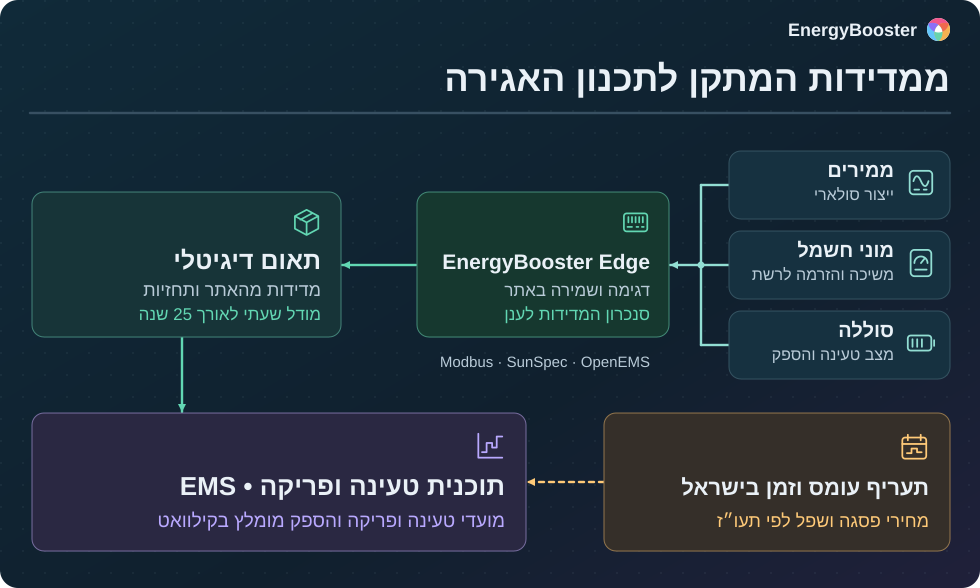
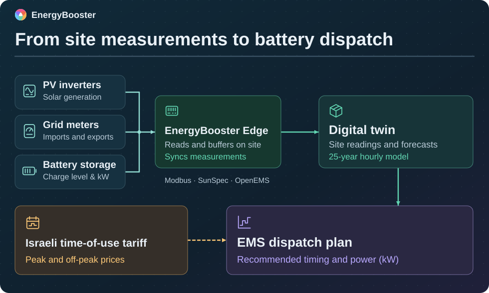

[English](https://github.com/energybooster-co-il/.github/blob/main/profile/README.en.md) · [עברית](#ניהול-אנרגיה-סולארית-עם-energybooster)

# ניהול אנרגיה סולארית עם EnergyBooster

**מערכת לניהול אנרגיה (EMS) במתקני ייצור סולארי ואגירה בישראל.** מתכנני המתקן יכולים לבחון בתאום הדיגיטלי איך בחירת הסוללה תשפיע על 25 שנות פעילות. אחרי החיבור לרשת, צוות התפעול משתמש בנתוני הבקר ובתעריף החל על המתקן כדי לתכנן את הטעינה והפריקה.

[סיור במערכת](https://energybooster.co.il/#tour) · [היכרות עם הבקר](https://energybooster.co.il/edge/) · [כניסה למערכת](https://energybooster.ai/signin/) · [יצירת קשר](https://energybooster.co.il/contact/)

<a href="https://raw.githubusercontent.com/energybooster-co-il/.github/main/assets/energy-flow-he.svg">
  <picture>
    <source media="(max-width: 700px)" srcset="https://raw.githubusercontent.com/energybooster-co-il/.github/main/assets/energy-flow-he-mobile.svg">
    
  </picture>
</a>

## הבקר המקומי והחיבור לציוד

**EnergyBooster Edge** הוא בקר תעשייתי להתקנה על מסילת DIN בארון החשמל. הוא מתחבר לרשת הציוד דרך Ethernet או לקו טורי מסוג RS-485. בהתאם לציוד באתר, הבקר קורא ממירים ומונים תואמי SunSpec באמצעות Modbus TCP, מונים ומוני משנה באמצעות Modbus RTU, ונתוני אגירה מבקר OpenEMS Edge.

מדידת הממיר מראה כמה המתקן מייצר. המונה בנקודת החיבור מראה כמה חשמל נמשך מהרשת או הוזרם אליה. נתוני הסוללה משלימים את התמונה עם מצב הטעינה והספק הטעינה או הפריקה. אם הקשר לאינטרנט נקטע, הבקר ממשיך לשמור את המדידות באתר ומשלים את הסנכרון עם התאום כשהקשר חוזר.

*הבקר התעשייתי בשלב פיילוט. בעמוד הבקר מוצגים החיבורים הפיזיים ודגם תלת־ממדי של החומרה.*

## ניהול הסוללה ואופטימיזציה של טעינה ופריקה

מנוע ה־EMS מחשב לוח טעינה ופריקה והספק יעד בקילוואט. הוא משקלל את תחזית הייצור, הביקוש באתר ומחירי החשמל, בכפוף לקיבולת הזמינה, לגבולות מצב הטעינה, להספק הממיר ולמגבלות היבוא והיצוא בנקודת החיבור.

> **גג מסחרי עם מגבלת הזרמה**
>
> במתקן כזה, ייצור הצהריים עשוי לעלות על מה שהעסק יכול לצרוך או להזרים לרשת. התאום משווה בין אגירת העודף לשימוש בעסק בשעות הפסגה לבין הזרמה בשעות המותרות לפי מסלול האסדרה. בהשוואה רואים כמה קוט״ש של ייצור אפשר לנצל, כמה חשמל ייחסך ברכישה מהרשת, ומה תהיה עלות השחיקה של הסוללה.

מצב הייעוץ מפיק המלצות הספק למפעיל. מסלול השליטה המקומית בסוללה נבדק מול סוללה מדומה, והוא כבוי כברירת מחדל. הפעלה במתקן דורשת בדיקה מול דגם הציוד ואישור חשמלאי.

## תעו״ז ואסדרת החשמל בישראל

התאום מתמחר בנפרד חשמל שנרכש מהרשת, חשמל שנצרך ישירות מהמתקן וחשמל שנמכר לרשת. עלות הרכישה נקבעת לפי תעריף עומס וזמן (תעו״ז) שנבחר, כולל עונה, יום בשבוע, חגים וחלונות פסגה ושפל. ההכנסה מהזרמה מחושבת לפי מסלול האסדרה של הפרויקט.

אפשר לבחון כיצד מדרגות הספק, מועד הבקשה או הסנכרון, פרמיה אורבנית ותעריף משלים לאגירה משפיעים על התזרים במסלולים הרלוונטיים. לצד התרחיש מופיעים מקור התעריף והנחות החישוב. לתקופה שאחרי סיום האסדרה אפשר להגדיר הנחת מחיר נפרדת. [מדריך התעריפים והאסדרה](https://energybooster.co.il/tariff/)

## תאום דיגיטלי לאורך 25 שנות פעילות

החישוב מתחיל בפריסת הפאנלים, בהצללה, במזג האוויר ובפרופיל הצריכה. בכל שעה התאום מחשב ייצור, צריכה, טעינה ופריקה, ואת יתרת החשמל שעוברת דרך המונה. מצב הסוללה עובר משעה לשעה. לאורך השנים המודל מביא בחשבון ירידה בתפוקת הפאנלים, לכלוך ושטיפות, שחיקת הסוללה והחלפת ציוד.

כך אפשר להשוות, למשל, שתי קיבולות אגירה ולראות באיזו שנה תידרש החלפת סוללה בכל תרחיש ומה המשמעות לתזרים המצטבר. כשהמתקן פעיל, המדידות מהבקר מאפשרות להשוות בין הביצועים החזויים לביצועים בפועל ולהחליט אילו פערים דורשים טיפול.

*מסך האגירה של מתקן הדגמה. הערכים המוצגים חושבו במודל.*

[תכנון מתקן מסחרי](https://energybooster.co.il/commercial/) · [תכנון אגירה](https://energybooster.co.il/storage/) · [ניטור מתקנים](https://energybooster.co.il/monitoring/)

---

[English](https://github.com/energybooster-co-il/.github/blob/main/profile/README.en.md) · [עברית](#ניהול-אנרגיה-סולארית-עם-energybooster)

# Solar energy management with EnergyBooster

**An energy management system (EMS) for solar and battery storage projects in Israel.** Engineers use the digital twin to see how a battery sizing decision plays out across 25 years. Once the plant is connected, operators use controller readings and the site’s electricity tariff to plan when the battery should charge and discharge.

[Product tour](https://energybooster.co.il/en/#tour) · [Explore the controller](https://energybooster.co.il/en/edge/) · [Sign in](https://energybooster.ai/signin/) · [Contact](https://energybooster.co.il/en/contact/)

<a href="https://raw.githubusercontent.com/energybooster-co-il/.github/main/assets/energy-flow-en.svg">
  <picture>
    <source media="(max-width: 700px)" srcset="https://raw.githubusercontent.com/energybooster-co-il/.github/main/assets/energy-flow-en-mobile.svg">
    
  </picture>
</a>

## The edge controller and field equipment

**EnergyBooster Edge** is an industrial controller that mounts on a DIN rail in the electrical cabinet. It connects to equipment over Ethernet or an RS-485 serial bus. Depending on the site, it can read SunSpec-compatible inverters and meters over Modbus TCP, meters and submeters over Modbus RTU, and storage telemetry from an OpenEMS Edge controller.

The inverter measures generation. The meter at the grid connection measures imports and exports. Battery telemetry adds state of charge and charging or discharging power. During an internet outage, the controller continues storing readings on site and syncs them to the twin when connectivity returns.

*The industrial controller is in pilot. The hardware guide shows its connectors and an interactive 3D model.*

## Battery management and dispatch optimization

The EMS calculates a charge and discharge schedule with a target power in kilowatts. It weighs forecast generation, site demand, and electricity prices against available battery capacity, state-of-charge limits, inverter power, and the import and export limits at the grid connection.

> **A commercial rooftop with an export limit**
>
> At midday, the array may generate more than the business can use or export. The twin compares storing that surplus to supply the business during peak-price hours with exporting stored energy when the project’s tariff arrangement allows. The operator can compare how much solar energy each schedule captures, how much grid electricity it displaces, and the cost of battery wear.

In advisory mode, the EMS recommends power targets to the operator. The local battery control path has been tested with a simulated battery and is disabled by default. Field operation requires validation against the installed equipment and electrician approval.

## Israeli time-of-use tariffs and regulation

The twin values grid purchases, on-site solar consumption, and exports separately. It prices purchases against the selected Israeli time-of-use tariff (TAOZ), accounting for the season, day of the week, holidays, and peak and off-peak periods. Export revenue follows the project’s regulatory arrangement.

Project teams can examine the effects of capacity bands, application or grid synchronization dates, the urban premium, and the supplementary storage tariff where applicable. Each scenario keeps its tariff reference and calculation assumptions. Teams can set a separate price assumption for the period after the regulatory arrangement expires. [Guide to Israeli tariffs and regulation](https://energybooster.co.il/en/tariff/)

## A digital twin across 25 years of operation

The simulation starts with the array layout, shading, local weather, and site load profile. Each hour, the twin accounts for generation, consumption, battery charging and discharging, and the energy that crosses the grid meter. Battery state carries forward from one hour to the next. Across years, the model accounts for module degradation, soiling and cleaning, battery aging, and equipment replacement.

An owner comparing two battery sizes can see when each scenario calls for a replacement and how that changes cumulative cash flow. Once the plant is operating, operators compare controller readings with the modeled baseline to identify performance gaps that warrant a site visit.

*Battery storage view of a demo site, with modeled values.*

[Commercial solar planning](https://energybooster.co.il/en/commercial/) · [Storage planning](https://energybooster.co.il/en/storage/) · [Site monitoring](https://energybooster.co.il/en/monitoring/)
